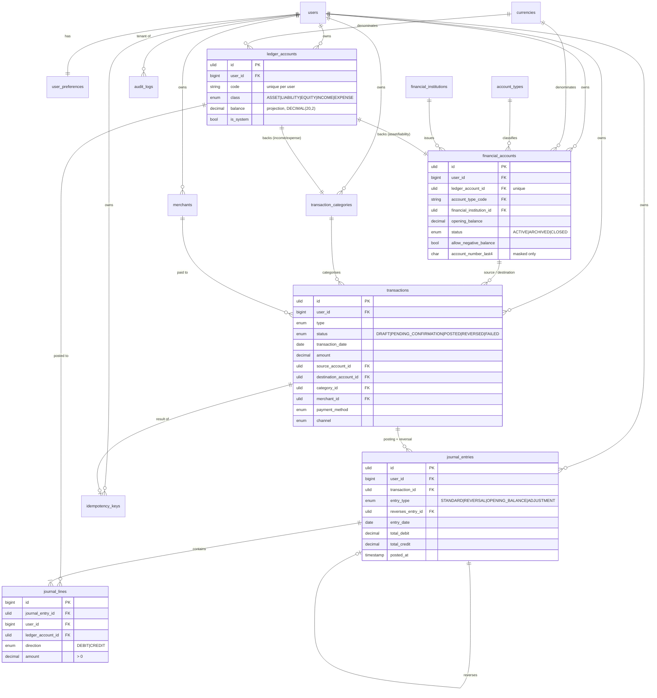

# Phase 1 — Core Ledger Design

> AI Personal Finance Tracker — *"One Money, Multiple Accounts, Complete Financial Visibility."*
>
> Status: **Implemented in Phase 1** unless marked *(planned)*.

---

## 1. Requirements analysis (Phase 1 scope)

| # | Requirement | Phase 1 decision |
|---|---|---|
| R1 | Multiple accounts (bank, cash, e-wallet, credit card, loan) | `financial_accounts` mapped 1:1 to a ledger account. |
| R2 | Double-entry: every posted transaction has balanced debit/credit lines | `LedgerPostingService` rejects any draft where Σdebit ≠ Σcredit, inside a locked DB transaction. |
| R3 | Internal transfers are never income or expense | Transfers post **asset ↔ asset** only, never touching INCOME/EXPENSE ledger accounts. |
| R4 | Balances derived from the ledger | `ledger_accounts.balance` is a *projection* updated in the same DB transaction as the journal lines and checked by `ledger:verify`. There's no API to edit a balance directly. |
| R5 | No floats for money | `DECIMAL(20,2)` in MySQL, `bcmath` strings in PHP (`Money` value object). JSON amounts must be integers or decimal **strings**; JSON floats are rejected. |
| R6 | Immutable posted journals; corrections by reversal | Model guards block `UPDATE`/`DELETE` on `journal_entries`/`journal_lines`; reversal posts a mirror entry. |
| R7 | Idempotent posting | `idempotency_keys` (unique per user+key) + request fingerprint; replay returns the original transaction, mismatched replay returns `409`. |
| R8 | Tenant isolation | Every domain row carries `user_id`. All look-ups are owner-scoped, and the posting service re-checks that every ledger account belongs to the entry's owner. |
| R9 | Concurrency safety | `SELECT … FOR UPDATE` on all touched ledger accounts, locked in deterministic (sorted) order to avoid deadlocks. |
| R10 | Auditability | `audit_logs` row for every posting, reversal and account creation; journals keep `posted_by`, `posted_at`. |
| R11 | Rp10,000,000 salary simulation | Automated test at service level **and** HTTP API level. |

Out of Phase 1 scope (planned): budgets, Telegram, AI parser, Chrome extension, imports, credit-card statements and installments, dashboards.

## 2. Accounting model

### 2.1 Ledger account classes

| Class | Normal balance | Examples | Increases with |
|---|---|---|---|
| ASSET | Debit | BCA, BNI, Cash Wallet, GoPay | Debit |
| LIABILITY | Credit | Credit Card BCA, Personal Loan | Credit |
| EQUITY | Credit | Opening Balance Equity, Reconciliation Adjustments | Credit |
| INCOME | Credit | Salary, Freelance, Interest | Credit |
| EXPENSE | Debit | Food, Transportation, Hosting, Interest & Fees | Debit |

`ledger_accounts.balance` is stored **in the account's normal-balance sign**: an asset with Rp4,000,000 has `balance = 4000000.00`, and a credit card with Rp500,000 owed has `balance = 500000.00`.

Each **financial account** (what the user sees: "BCA Payroll") owns exactly one ASSET or LIABILITY ledger account.
Each **category** ("Food", "Salary") owns exactly one INCOME or EXPENSE ledger account. Reports by category are therefore direct ledger reads.

### 2.2 Debit/credit posting rules

| Transaction | Debit | Credit | Type |
|---|---|---|---|
| Income Rp X to BCA | BCA (asset) | Income:Salary | `INCOME` |
| Expense Rp X from Cash | Expense:Food | Cash (asset) | `EXPENSE` |
| Transfer BCA → BNI | BNI (asset) | BCA (asset) | `INTERNAL_TRANSFER` |
| Cash withdrawal BCA → Cash | Cash (asset) | BCA (asset) | `INTERNAL_TRANSFER` |
| Credit-card purchase | Expense:Category | Credit Card (liability) | `EXPENSE` |
| Credit-card payment from Mandiri | Credit Card (liability) | Mandiri (asset) | `LIABILITY_PAYMENT` |
| Loan disbursement into BCA | BCA (asset) | Loan (liability) | `LIABILITY_DRAWDOWN` |
| Loan principal payment | Loan (liability) | BCA (asset) | `LIABILITY_PAYMENT` |
| Loan interest / card fee | Expense:Interest & Fees | BCA (asset) | `EXPENSE` |
| Refund received to card | Credit Card (liability) | Income/expense category | `INCOME` |
| Opening balance (asset) | Asset | Equity:Opening Balance | `ADJUSTMENT` |
| Opening balance (liability) | Equity:Opening Balance | Liability | `ADJUSTMENT` |
| Reversal of any entry | *mirror of original credits* | *mirror of original debits* | original type, status → `REVERSED` |

Consequences:

* **Transfers never touch INCOME/EXPENSE accounts**, so they can't inflate income or expense totals. Σassets is unchanged.
* **Loan principal is not an expense.** Paying principal debits the liability. Only interest/fees are posted to an expense category.
* **Budget allocations** *(Phase 2)* live in `budget_*` tables and produce **no journal lines**.

### 2.3 Reporting definitions (all from posted journal lines)

| Metric | Definition |
|---|---|
| Total income | Σ(credit − debit) on INCOME accounts, `entry_date` in period |
| Total expenses | Σ(debit − credit) on EXPENSE accounts, `entry_date` in period |
| Net income | income − expenses |
| Total internal transfers | Σ amount of `POSTED` transactions of type `INTERNAL_TRANSFER` in period |
| Total assets | Σ(debit − credit) on ASSET accounts, `entry_date ≤ period end` |
| Total liabilities | Σ(credit − debit) on LIABILITY accounts, `entry_date ≤ period end` |
| Net worth | assets − liabilities |
| Net cash flow | Net change of ASSET accounts in period, **excluding** opening-balance/adjustment entries |

Reversal entries are dated at the **original transaction date**, with their own `posted_at` timestamp. A reversed transaction drops out of that period's reports, and the audit trail still records when it was reversed.

### 2.4 Acceptance scenario (automated test)

| Step | Journal |
|---|---|
| Salary Rp10,000,000 to BCA | Dr BCA 10,000,000 / Cr Income:Salary |
| BCA → BNI 2,000,000 | Dr BNI / Cr BCA |
| BCA → Cash 2,000,000 | Dr Cash / Cr BCA |
| BCA → Mandiri 1,000,000 | Dr Mandiri / Cr BCA |
| BCA → CIMB Niaga 1,000,000 | Dr CIMB / Cr BCA |
| Sate 35,000 cash | Dr Expense:Food / Cr Cash |
| Drink 10,000 BNI QRIS | Dr Expense:Food / Cr BNI |

Result: BCA 4,000,000 · BNI 1,990,000 · Cash 1,965,000 · Mandiri 1,000,000 · CIMB 1,000,000.
Income 10,000,000 · Expenses 45,000 · Transfers 6,000,000 · Assets 9,955,000 · Net cash flow 9,955,000.

## 3. ERD (Phase 1 tables)



Integrity rules enforced in the database (MySQL/MariaDB):

* `CHECK (amount > 0)` on `journal_lines` and `transactions`; `CHECK (total_debit = total_credit)` on `journal_entries`.
* Foreign keys with `RESTRICT` on every ledger reference, so a posted line's account can't be deleted.
* `UNIQUE(user_id, code)` on `ledger_accounts`, `UNIQUE(user_id, idempotency_key)` on `idempotency_keys`.

## 4. Posting algorithm (`LedgerPostingService::post`)

```
BEGIN (or SAVEPOINT if already in a transaction)
  validate draft: ≥2 lines, every amount > 0 (bcmath), single currency, Σdebit == Σcredit
  SELECT … FROM ledger_accounts WHERE id IN (…) ORDER BY id FOR UPDATE   -- deterministic lock order
  assert every account exists, is ACTIVE, belongs to draft.user_id, matches currency
  INSERT journal_entries (+ totals)
  INSERT journal_lines
  UPDATE ledger_accounts SET balance = balance ± amount   -- normal-balance aware
  -- caller (TransactionService) then checks overdraft rules on locked rows
COMMIT
```

Any exception rolls back the entry, its lines, the projection update, the `transactions` row, the idempotency key and the audit log together.

## 5. Module boundaries

```
app/Modules/
  Shared/        Money value object, base DomainException, API response helpers, MoneyAmount rule
  Identity/      Registration, login/logout (Sanctum), user provisioning
  Ledger/        Chart of accounts, journal posting, reversal, integrity verification (ledger:verify)
  Accounts/      Financial accounts, account types, institutions, opening balances
  Categories/    Income/expense categories, merchants
  Transactions/  Income, expense, transfer, liability payment/drawdown, reversal, idempotency
  Reporting/     Financial summary (income, expenses, transfers, assets, liabilities, net worth, cash flow)
  Audit/         Audit log writer
```

Dependency direction: `Transactions → Ledger`, `Accounts → Ledger`, `Reporting → Ledger (read)`.
**Only `Ledger\Services\LedgerPostingService` writes `journal_*` rows or changes `ledger_accounts.balance`.**
Controllers are thin: validate → build input DTO → call one service → return a resource.

Planned modules (later phases): `Budgets`, `Liabilities`, `Reconciliation`, `Imports`, `AI`, `Telegram`, `Notifications`, `Integrations`.

## 6. Data protection & ISO/IEC 27001:2022 alignment (Phase 1)

| Control | Implementation |
|---|---|
| A.8.5 Secure authentication | Hashed passwords (bcrypt via Laravel `Hash`), Sanctum tokens with expiry, login rate-limit |
| A.8.3 Information access restriction | Owner-scoped queries plus policies, and 404 (not 403) for other tenants' resources |
| A.8.11 Data masking | Only the last 4 digits of account numbers are stored; full numbers are never accepted |
| A.8.15 Logging | `audit_logs` for postings, reversals and account changes. No secrets or tokens are logged |
| A.8.24 Use of cryptography | Secrets only in `.env` (never committed); `APP_KEY` encryption; HTTPS in production |
| A.8.10 Information deletion | Retention settings planned for audit logs/idempotency keys (`AUDIT_RETENTION_DAYS`, `IDEMPOTENCY_TTL_HOURS`) |
| A.8.12 Data leakage prevention | No financial data is sent to external services in Phase 1 (AI is a later phase and will minimise payloads) |
| A.8.28 Secure coding | Validation on every input, no raw SQL interpolation, no float money |
